# PoolPilot

本地运行的**资金池分析与跟单工作台**，数据源为 Lighter（zk-rollup 永续 DEX）的公共资金池。

用途：评估某个资金池是否值得跟随、跟单的摩擦成本有多大、跟单至少需要多少本金。

工作流可以概括为一行：

```
池的仓位变动 → 带单员记为信号 → 跟单员按比例复制 → 纸面账（模拟成交）或交易所账号（真实下单）
```

三个术语贯穿全系统：

| 术语 | 含义 |
|---|---|
| **池** | Lighter 上的公共资金池（用户池 / 协议池 / 质押池），系统观察的对象 |
| **带单员** | 对一个池的持续观察者：记录该池的持仓与成交变动，产出信号。它的存在与有没有人跟无关 |
| **跟单员** | 信号的订阅者：各有独立本金与独立账本，可纸面、可实盘。一个带单员可被多个跟单员订阅 |

规模口径为**比例复制**：跟单员的目标仓位 = 池的仓位 × 跟单员本金 ÷ 池的权益。

## 功能

| 功能 | 说明 |
|---|---|
| 池列表 | 全量公共资金池及横截面指标（总资产、年化利率、夏普比率、运营费、份额），可按池类型筛选 |
| 池详情 | 净值曲线；收益与风险指标；当前持仓、挂单与近期成交 |
| 带单员 | 对某个池建立、暂停或停止观察，记录累计信号数与订阅数 |
| 纸面跟单 | 按真实盘口模拟成交并完整记账：权益曲线、成交/跳过记录、跟踪偏差、执行成本测量 |
| 实盘跟单 | 把信号复制到交易所账号并真实下单（开仓 / 平仓），持仓与盈亏以交易所数据为准 |
| 标的映射 | 跨平台同一资产的例外表（默认同名直接使用），以两侧价格比值判断是否同一物 |
| 规模门槛 | 给定本金，逐市场算出理想跟单规模、所需本金与敞口放大倍数 |
| 回测 | 以池的净值序列为基准，按往返成本与日均交易次数做情景推演，并与「直接入池」对比 |

池的收益指标同时给出**上游上报值**与**本机按净值序列实算值**，两者口径不同，页面上并列显示、不混用。

## 边界与限制

- **不在 Lighter 上下单。** Lighter 的下单必须用其自研签名方案，而 .NET 生态没有可用签名器
  （官方只提供 Go 编译的 WASM、C 动态库与 Python SDK）。Lighter 在本系统里是只读数据源。
- **实盘执行只有币安 U 本位永续。** OKX 与 Gate 目前只有合约目录（供标的映射查询）。
  新增一家执行场所只需实现 `IExchangeBroker` 接口，领域层不需要改动。
- **回测是情景推演，不是历史回放。** 上游不提供历史成交明细（交易频道只能取到近端快照），
  跟单摩擦按给定参数假设；池的净值序列本身来自上游，是真实数据。
- **凭据以明文保存在本机数据库**（未加密），建议只放权限最小、可随时吊销的密钥；
  配置本身不会触发交易，须由实盘跟单员引用。详见 [docs/EXCHANGES.md](docs/EXCHANGES.md)。

## 界面

### 总览

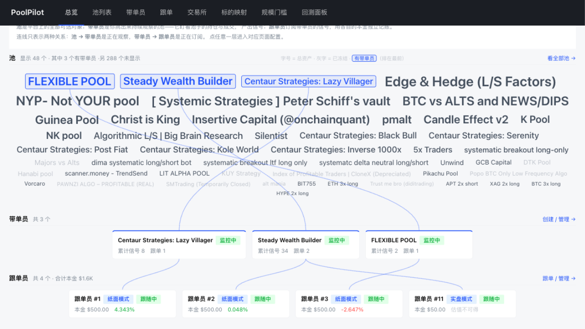

一屏画三层关系：池（标签云，字号对应总资产）、带单员、跟单员。连线只表示两种关系——
池 → 带单员是正在观察，带单员 → 跟单员是正在订阅。

### 池列表与池详情

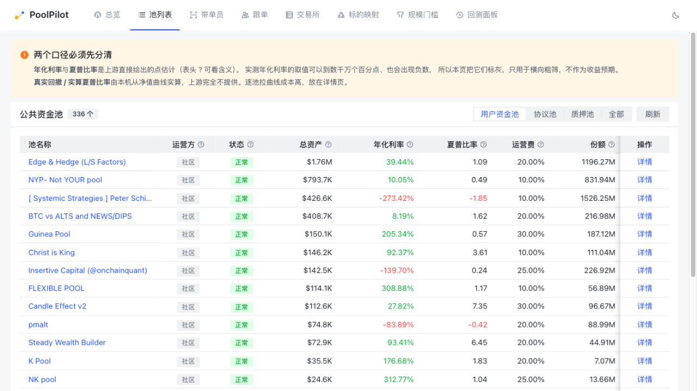

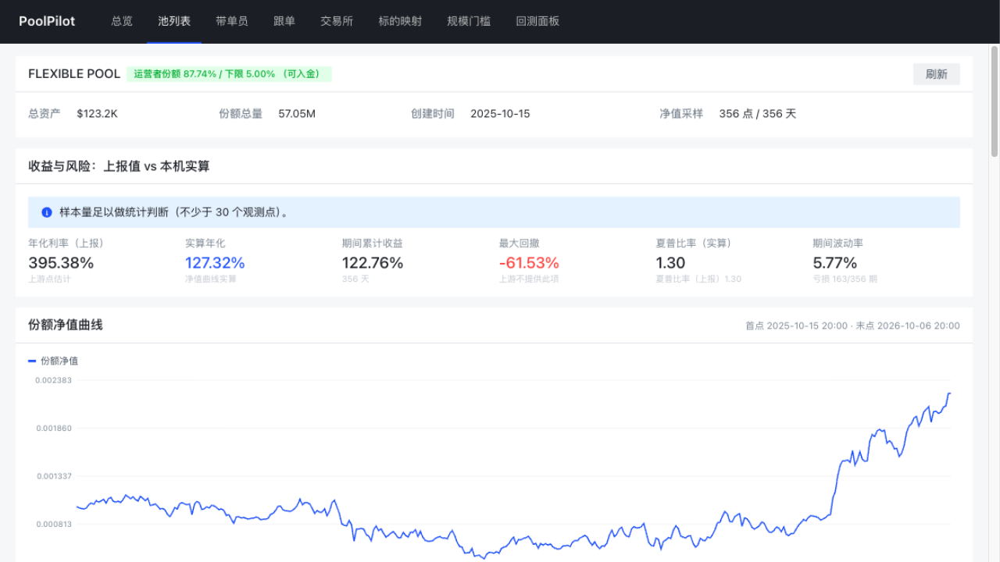

列表给出全量池的横截面指标，可按池类型筛选。详情页给出净值曲线、收益与风险指标
（上报值与本机实算并列）、当前持仓、挂单与近期成交。

### 带单员与跟单员

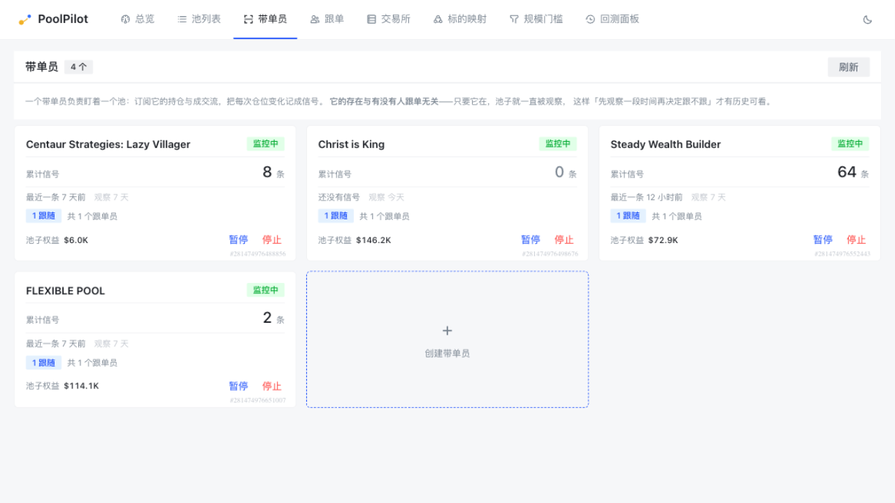

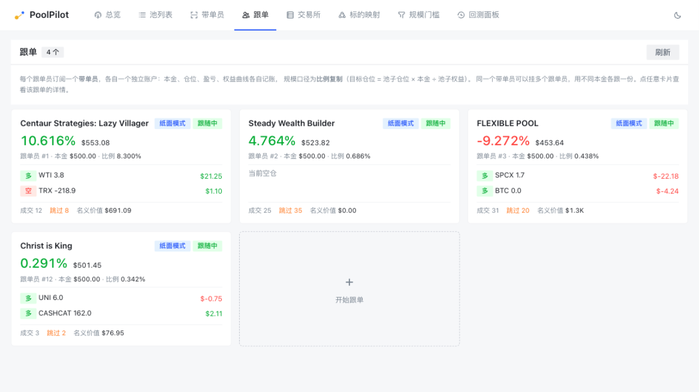

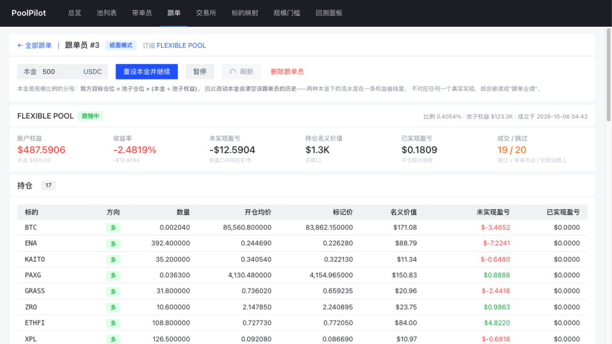

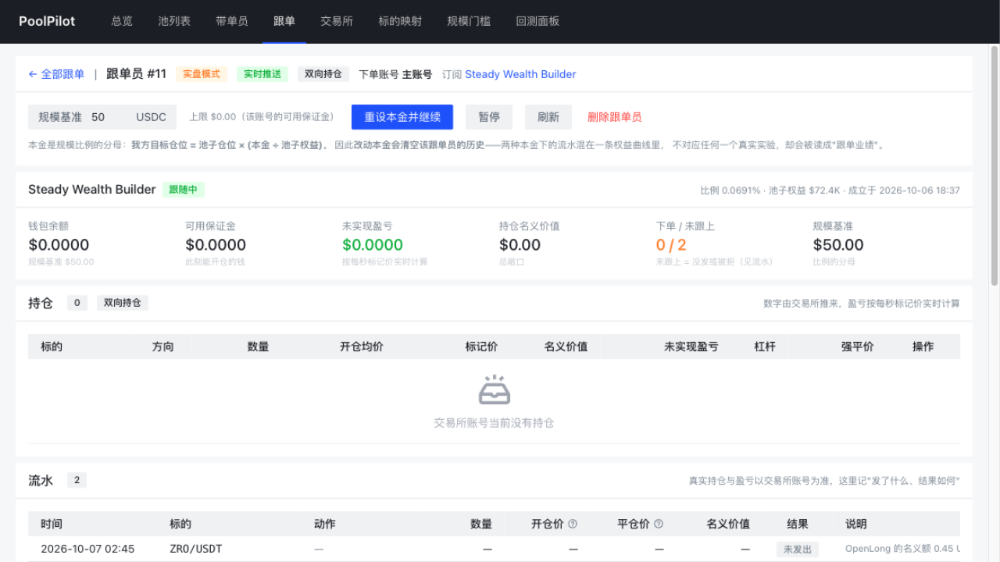

带单员列表按池给出一条观察记录（累计信号数、订阅数）。跟单列表每个跟单员一张卡片，
显示本金、收益率或账户余额、持仓摘要与成交/跳过计数。详情页两种模式共用同一版式：
概览、持仓、流水；纸面另有权益曲线与执行成本测量，实盘另有杠杆、强平价与手动平仓。

### 配置与工具

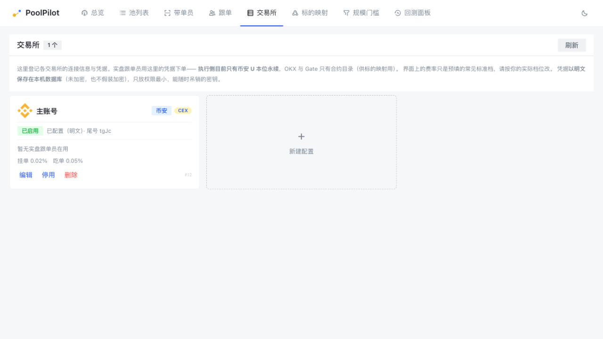

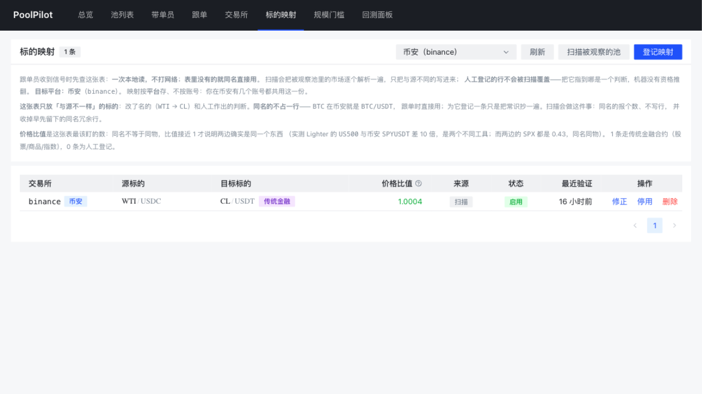

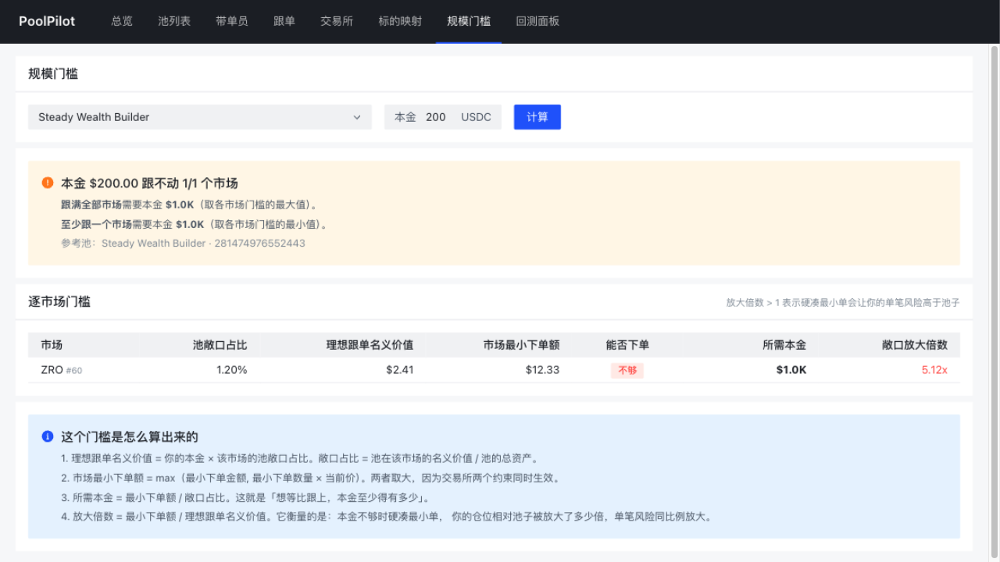

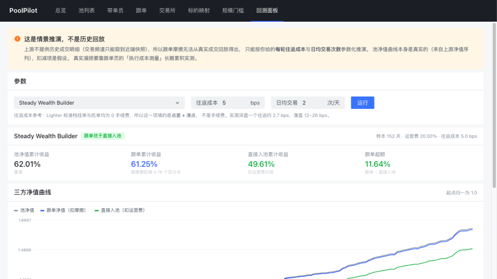

交易所页登记各平台的连接信息与凭据；标的映射是跨平台同一资产的例外表（含来源、状态与价格比值）；
规模门槛按本金算出逐个市场的可行性；回测面板按参数推演跟单净值并与直接入池对比。

## 技术栈

| 层 | 技术 |
|---|---|
| 后端 | C# 14 / .NET 10 · ASP.NET Core · EF Core 10 + SQLite · SignalR |
| 前端 | Vue 3.5 · TypeScript 6 · Vite 8 · Arco Design Vue 2.58 |
| 测试 | MSTest 4（四层单元测试 + 真实接口契约测试） |

架构为整洁架构四层：`Domain ← Application ← Infrastructure ← Api`。
领域层零外部依赖，上游的字段口径全部在该层固化为类型约束。

## 目录

```
PoolPilot.slnx
src/
  PoolPilot.Domain/          领域模型与领域服务（零外部依赖）
  PoolPilot.Application/     用例与 DTO
  PoolPilot.Infrastructure/  Lighter 客户端、交易所对接、持久化、常驻监控
  PoolPilot.Api/             Controllers、SignalR Hub、组合根
tests/
  PoolPilot.Domain.Tests/    字段口径断言
  PoolPilot.Application.Tests/
  PoolPilot.Api.Tests/
  PoolPilot.Lighter.Tests/   真实接口契约测试（[TestCategory("Live")]）
web/                         Vue 工作台
docs/                        编码规范、接口实测笔记、角色关系、凭据与账务口径；docs/images/ 为界面截图
```

## 环境要求

| 需要 | 版本 | 用途 |
|---|---|---|
| [.NET SDK](https://dotnet.microsoft.com/download) | 10.0.3xx 或更高特性带（`global.json` 固定 10.0.302，允许向上滚动） | 后端与测试；SDK 自带 ASP.NET Core runtime |
| [Node.js](https://nodejs.org/) | 20.19+ 或 22.12+（Vite 8 的要求） | 前端构建与开发服务器 |
| npm | 随 Node 附带 | 前端依赖 |

目标框架 `net10.0`（C# 14）。**不需要数据库服务**：持久化用 SQLite，库文件由运行时在 `data/` 下创建。
运行期需要网络：池数据来自 Lighter 的公共 API；启用实盘时还会访问所选交易所的接口。

## 运行

```bash
# 后端 → http://localhost:5274
dotnet run --project src/PoolPilot.Api

# 前端 → http://localhost:5273（已配置 /api 与 /hubs 反代到 5274）
cd web
npm install
npm run dev
```

## 测试

```bash
dotnet test                                # 全部
dotnet test --filter "TestCategory!=Live"  # 跳过需要联网的契约测试
```

## 文档

| 文档 | 内容 |
|---|---|
| [AGENTS.md](AGENTS.md) | AI 角色画像与工作准则 |
| [docs/CODING_STANDARDS.md](docs/CODING_STANDARDS.md) | 分层、C# 规范、测试规范、数据访问规范 |
| [docs/LIGHTER-API-NOTES.md](docs/LIGHTER-API-NOTES.md) | Lighter 接口实测笔记——领域模型的唯一依据 |
| [docs/LEAD-FOLLOWERS.md](docs/LEAD-FOLLOWERS.md) | 带单员与跟单员的职责边界、信号、触发模型与已知限制 |
| [docs/EXCHANGES.md](docs/EXCHANGES.md) | 交易所配置与凭据：为什么**不加密**、凭据三态与最小权限建议 |
| [docs/PAPER-TRADING.md](docs/PAPER-TRADING.md) | 纸面跟单的会计口径（比例复制、跳过记录、权益点） |

要理解领域层为什么长成现在这样，先读 `docs/LIGHTER-API-NOTES.md`：它记录了上游的字段陷阱
（四种时间刻度、两种保证金率刻度、本身就是百分数的字段、恒为 0 的死字段），
以及官方文档与实测相矛盾的四处。
